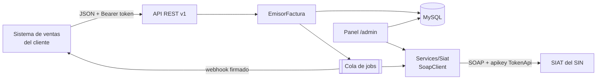
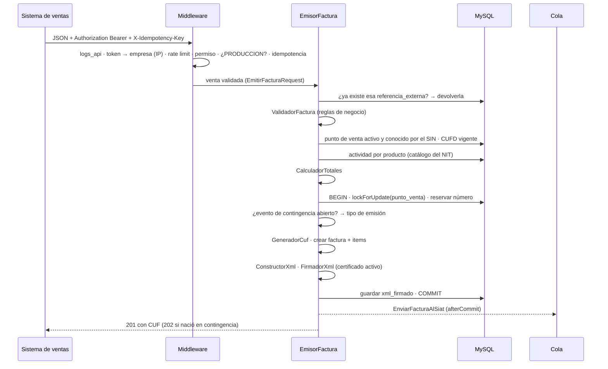
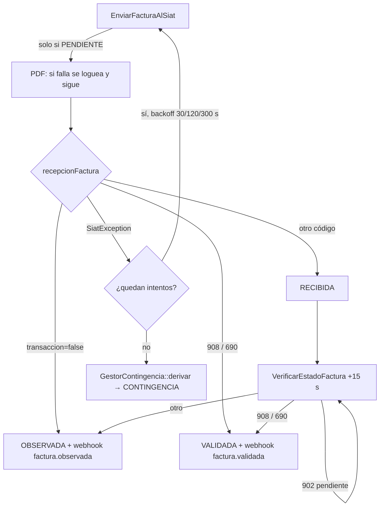

# Arquitectura — siat-api

> Cómo está construido el sistema y por qué. Para operar el servidor ver
> [OPERACION.md](OPERACION.md); para integrar un sistema de ventas ver [integracion/API.md](integracion/API.md).

---

## 1. Qué es

`siat-api` es un **proveedor de facturación electrónica** ante el SIAT (Servicio de Impuestos
Nacionales de Bolivia). Atiende a **varios clientes** (ferreterías, restaurantes, etc.) desde
una sola instalación.

| Aspecto | Valor |
|---|---|
| Modalidad | Electrónica en línea (`codigoModalidad = 1`) |
| Documento | **Sector 1 — Factura Compra Venta** (`codigoDocumentoSector = 1`), con derecho a crédito fiscal (`tipoFacturaDocumento = 1`) |
| Ambientes | 1 = producción, 2 = piloto (cada empresa tiene el suyo) |
| Stack | PHP 8.3 · Laravel 13 · MySQL · colas en base de datos · Blade (panel) · Pest 4 |

El sistema de ventas del cliente **no habla SOAP ni firma nada**: manda un JSON a la API REST y
recibe el CUF al toque. Todo lo demás —CUIS, CUFD, CUF, XML, firma digital, envío, verificación,
anulación, contingencia, catálogos— lo resuelve este sistema.

---

## 2. Mapa de carpetas

| Carpeta | Qué contiene |
|---|---|
| `app/Http/Controllers/Api/V1` | API REST para el sistema de ventas: facturas, puntos de venta, catálogos, estado |
| `app/Http/Controllers/Admin` | Panel `/admin`: empresas, certificados, sucursales, puntos de venta, códigos, piloto, monitor |
| `app/Http/Middleware` | `siat.registro`, `siat.token`, `siat.permiso`, `siat.rate`, `siat.produccion`, `siat.idempotencia` |
| `app/Http/Requests` | Validación de forma del JSON (`EmitirFacturaRequest`, `AnularFacturaRequest`) |
| `app/Services/Factura` | Emisión: validación, totales, CUF, XML, firma, PDF, QR |
| `app/Services/Siat` | **Única frontera SOAP**: cliente, servicios por WSDL, gestor de CUIS/CUFD, lectura de respuestas |
| `app/Services/Contingencia` | Eventos significativos y armado de paquetes |
| `app/Services/Catalogos` | Sincronización de catálogos globales y por NIT |
| `app/Services/Pruebas` | Ejecutor del piloto ante el SIN |
| `app/Services/Panel` | Lógica de presentación del panel (colores de estado, checklist de etapa) |
| `app/Services/Webhooks` | Validación del destino de los webhooks (anti-SSRF) |
| `app/Jobs` | Trabajo en segundo plano (envío, verificación, anulación, paquetes, webhooks, CUFD, piloto) |
| `app/Console/Commands` | Comandos `siat:*` (ver [OPERACION.md](OPERACION.md#5-comandos-siat)) |
| `routes/console.php` | Tareas programadas |
| `config/siat.php` | Toda la configuración propia del dominio |

---

## 3. Reglas de diseño

1. **Nada de SOAP fuera de `app/Services/Siat/`.** Nadie más construye un `SoapClient`. Jobs,
   comandos y controladores piden los servicios a `FabricaServicios`, que se resuelve del
   contenedor y en los tests se reemplaza con Mockery.
2. **La venta nunca espera al SIN.** La emisión es síncrona hasta tener el XML firmado (~150 ms)
   y el viaje al SIN es asíncrono.
3. **Multi-empresa por `empresa_id`.** Cada consulta de la API filtra por la empresa autenticada;
   cada empresa tiene su token, su certificado, su ambiente y sus catálogos.
4. **El documento firmado es inmutable.** Actividad económica, leyenda, código de excepción y
   montos se resuelven al emitir y quedan guardados: un cambio posterior de catálogos no altera
   una factura ya emitida.
5. **El SIN rechaza sin SoapFault.** Responde HTTP 200 con `transaccion = false`; por eso toda
   respuesta pasa por `RespuestaSiat`, que distingue aceptación de rechazo y extrae el motivo.
6. **Sin roles.** Un solo administrador del panel (decisión de producto).

---

## 4. Flujo de emisión

### 4.1 Parte síncrona (`POST /api/v1/facturas`)

Detalles clave (todos en `app/Services/Factura/EmisorFactura.php`):

- **Correlativo sin huecos ni duplicados.** El número se reserva dentro de la transacción con
  bloqueo de fila del punto de venta. Si algo falla después (por ejemplo, la firma), el rollback
  devuelve el número.
- **Fecha sin milisegundos.** `fecha_emision` se guarda en segundos y el CUF lleva la fecha con
  milisegundos: se usa `now()->startOfSecond()` para que el CUF y `<fechaEmision>` coincidan.
- **Tipo de emisión antes del CUF.** El tipo de emisión es uno de los nueve campos del CUF; se
  decide (en línea o contingencia) antes de calcularlo.
- **Certificado.** Sin certificado activo no se emite (la modalidad electrónica exige firma). Un
  certificado **vencido** tampoco firma (el SIN rechazaría todo), y un autofirmado de prueba no
  puede firmar en ambiente de producción.
- **Tarjeta.** `numero_tarjeta` se enmascara antes de guardar (4 primeros + ceros + 4 últimos).
- **Idempotencia.** Índice único `(empresa_id, referencia_externa)`; si dos peticiones iguales
  corren en paralelo, la que pierde la carrera devuelve la factura de la que ganó.

### 4.2 Parte asíncrona

---

## 5. Máquina de estados de la factura

| Estado | Significado | Sale hacia |
|---|---|---|
| `PENDIENTE` | Emitida y firmada; todavía no viajó | `RECIBIDA`, `VALIDADA`, `OBSERVADA`, `CONTINGENCIA` |
| `RECIBIDA` | El SIN acusó recibo individual, sin validar aún | `VALIDADA`, `OBSERVADA`, `ANULADA` |
| `ENVIADA` | Viajó dentro de un paquete de contingencia | `VALIDADA`, `OBSERVADA`, `ANULADA` |
| `VALIDADA` | El SIN la aceptó (908/690) | `ANULADA` |
| `OBSERVADA` | El SIN la rechazó; no se reintenta (el documento no cambia) | — |
| `CONTINGENCIA` | Válida e imprimible, pendiente de viajar en un paquete | `ENVIADA` |
| `ANULADA` | Anulación registrada (ver `facturas_anuladas.estado`) | vuelve al estado anterior si el SIN rechaza la anulación |

Anulación (`facturas_anuladas.estado`): `PENDIENTE` → `CONFIRMADA` | `RECHAZADA` (la factura vuelve
a su `estado_anterior`) | `REVERTIDA` (reversión hecha en el piloto).

---

## 6. Trabajo asíncrono

### 6.1 Jobs

Van en tres colas que el worker atiende por prioridad (`--queue=facturas,default,piloto`):
`facturas` (envío, verificación, anulación, paquetes), `default` (webhooks, CUFD, catálogos) y
`piloto` (pruebas). Así una etapa del piloto de un cliente nuevo no atrasa la facturación de los
demás. La cola se declara con el atributo `#[Queue('...')]` en cada job.

| Job | Disparado por | Intentos / backoff | Qué hace |
|---|---|---|---|
| `EnviarFacturaAlSiat` | Emisión (afterCommit), tarea `reintentar-pendientes` | 3 · 30/120/300 s | Genera PDF y llama `recepcionFactura`. Solo actúa sobre facturas `PENDIENTE`. Agotados los intentos, deriva a contingencia |
| `VerificarEstadoFactura` | `EnviarFacturaAlSiat`, tarea `verificar-enviadas` | 5 · 60/120/300/600 s | Llama `verificacionEstadoFactura`. 902 = reintenta. En el último intento no se reencola: la retoma la tarea programada |
| `AnularFacturaEnSiat` | `POST .../anular`, tarea `reintentar-anulaciones` | 5 · 30/120/300/900 s | Llama `anulacionFactura`. **Único por factura** (`ShouldBeUnique`, 1 h). Si el SIN rechaza, revierte la factura. Agotados los intentos queda `PENDIENTE` |
| `EnviarPaqueteContingencia` | `siat:recuperar-contingencia`, piloto | 3 · 60/300/900 s | Arma el TAR, llama `recepcionPaqueteFactura`, marca las facturas `ENVIADA` |
| `NotificarWebhook` | Cambios de estado | 5 · 10/30/60/120 s | POST firmado al `webhook_url` del cliente |
| `RenovarCufd` | `siat:renovar-cufds` | 3 | Pide un CUFD nuevo (y el CUIS antes si venció). Ignora puntos de venta no registrados en el SIN y empresas sin token |
| `EjecutarCasoPrueba` | Panel del piloto | — | Ejecuta una llamada del piloto (etapas largas) |
| `SincronizarCatalogosEmpresa` | Tarea `sincronizar-catalogos-empresas` | 3 · 300/900 s | Sincroniza actividades, productos homologados y leyendas del NIT con un punto de venta que tenga CUIS vigente (se salta la empresa si no hay). El panel tiene además el botón **Sincronizar ahora** (síncrono) |

### 6.2 Tareas programadas (`routes/console.php`)

| Frecuencia | Tarea | Qué hace |
|---|---|---|
| cada 5 min | `reintentar-pendientes` | Reencola facturas `PENDIENTE` con más de 10 min (máx. 200) |
| cada 10 min | `siat:recuperar-contingencia` | Si el SIAT responde: registra el evento, lo cierra y despacha el paquete |
| cada 15 min | `verificar-enviadas` | Reencola la verificación de `ENVIADA`/`RECIBIDA` con más de 20 min |
| cada 15 min | `reintentar-anulaciones` | Reencola anulaciones `PENDIENTE` con más de 30 min |
| cada hora | `siat:renovar-cufds` | Renueva los CUFD que vencen en menos de 2 h |
| diario 02:00 | `siat:revisar-codigos` | Pide un CUIS nuevo a los puntos de venta que lo perdieron (no se puede antes: con uno vigente el SIN devuelve el mismo) |
| diario 04:00 | `siat:purgar-logs` | Borra `logs_siat` más viejos que la retención |
| diario 07:00 | `siat:avisar-certificados` | Alerta certificados y tokens delegados vencidos o que vencen en menos de 30 días (también al log) |
| diario 03:30 | `sincronizar-catalogos-empresas` | Despacha `SincronizarCatalogosEmpresa` por cada empresa con token |
| domingo 03:00 | `siat:sincronizar-globales` | Catálogos paramétricos globales |

### 6.3 CUFD en dos capas

Los sistemas de venta **no manejan códigos**: la API los consigue sola.

- **Preventiva:** `siat:renovar-cufds` cada hora renueva lo que vence en menos de 2 h.
- **Reactiva:** si al emitir no hay CUFD vigente, `EmisorFactura` lo pide en ese momento
  (`GestorCodigos::asegurarCufd`, con lock por punto de venta para que dos cajas no pidan dos).
  Si el SIN falla, responde `503 SIAT_NO_DISPONIBLE` y no reintenta durante 60 s; en contingencia
  ni lo intenta (solo sumaría la espera del timeout).
- **CUIS:** `siat:revisar-codigos` diario y, si falta al pedir un CUFD, se pide antes. Cuando el
  SIN entrega un CUIS **nuevo**, se pide en seguida un CUFD atado a él (`GestorCodigos::renovarCuis`):
  el SIN rechaza con 913 un CUFD que viaja con un CUIS distinto al que lo generó.
- **Emergencia:** `POST /api/v1/puntos-venta/{s}/{pv}/cufd` (permiso `codigos:renovar`, 3 por hora).

---

## 7. Frontera SOAP (`app/Services/Siat`)

| Clase | Responsabilidad |
|---|---|
| `SiatClient` | Construye el `SoapClient`: URL del WSDL por ambiente, cabecera `apikey: TokenApi {token}`, gzip, traza, y **timeout de lectura** (`default_socket_timeout`) tanto al bajar el WSDL como al invocar |
| `ServicioBase` | Cabecera común (`codigoAmbiente`, `codigoSistema`, `codigoModalidad`, `nit`), invocación y auditoría en `logs_siat` (XML enviado/recibido, duración, éxito). Envuelve todo error en `SiatException` |
| `ServicioCodigos` | `verificarComunicacion`, `cuis`, `cufd`, `verificarNit` |
| `ServicioSincronizacion` | `sincronizarFechaHora`, actividades, productos/servicios, leyendas y cualquier otra paramétrica por el nombre de su operación (`parametrica()`) |
| `ServicioOperaciones` | `registroPuntoVenta`, `consultaPuntoVenta`, `cierreOperacionesSistema`, `registroEventoSignificativo` |
| `ServicioFacturacion` | `recepcionFactura`, `verificacionEstadoFactura`, `anulacionFactura`, `reversionAnulacionFactura`, `recepcionPaqueteFactura`, `validacionRecepcionPaqueteFactura`. Comprime en gzip y calcula el SHA-256 **del gzip** |
| `GestorCodigos` | Único lugar que pide y guarda CUIS/CUFD (`asegurarCuis`, `asegurarCufd`, `renovarCufd`, `renovarCuis`, `forzarCuisNuevo`). Rechaza respuestas sin código o sin código de control; usa la vigencia que declara el SIN; ata cada CUFD al CUIS que lo generó |
| `RespuestaSiat` | Interpreta `transaccion`, `codigoRecepcion`, `codigoEstado`, `mensajesList` |
| `FabricaServicios` | Construye los servicios por empresa; punto de sustitución en tests |

Detalles del contrato con el SIN (qué está verificado y qué no) en
[CONTRATO-SIAT.md](CONTRATO-SIAT.md).

---

## 8. Emisión: componentes de `app/Services/Factura`

| Clase | Qué hace |
|---|---|
| `ValidadorFactura` | Reglas que el FormRequest no cubre: descuentos que superan la línea, total negativo, gift card mayor al total, excepción de NIT sin documento NIT. También la usa el piloto, que emite sin FormRequest |
| `CalculadorTotales` | Subtotales por línea, monto total = bruto − descuentos de línea − descuento global; **sujeto a IVA = monto total − gift card**. Redondeo a 2 decimales |
| `ResolutorActividad` | Actividad económica por producto homologado y leyenda (al azar entre las de la actividad) |
| `GeneradorCuf` | 9 campos a ancho fijo (53 dígitos) + verificador módulo 11 → base 16 + código de control del CUFD |
| `ConstructorXml` | `facturaElectronicaCompraVenta` con `xsi:noNamespaceSchemaLocation`; los vacíos van con `xsi:nil="true"` |
| `FirmadorXml` | Firma XML-DSig enveloped RSA-SHA256 con el `.p12`. **XAdES-BES pendiente** |
| `MontoEnLetras` | Monto en literal para el "Son: … 00/100 BOLIVIANOS" |
| `GeneradorPdf` / `GeneradorQr` | Representación imprimible (dompdf) y QR de verificación; la URL del QR depende del ambiente de la empresa (`siat.qr.urls`) |
| `GeneradorCertificadoPrueba` | `.p12` autofirmado, solo para el piloto |

---

## 9. Contingencia (`app/Services/Contingencia`)

1. `EnviarFacturaAlSiat` agota sus intentos → `GestorContingencia::derivar()` marca la factura
   `CONTINGENCIA` y abre un `EventoSignificativo` (motivo 1) con el CUFD en uso.
2. Mientras el evento está abierto, cada factura nueva nace con `tipo_emision = 2` y su CUF lo
   refleja.
3. `siat:recuperar-contingencia` (cada 10 min) sondea con `verificarComunicacion`; si el SIAT
   responde, registra el evento en el SIN (pidiendo CUFD nuevo si hace falta), lo cierra y arma un
   `Paquete` con las facturas acumuladas.
4. `EnviarPaqueteContingencia` envía el TAR (un XML firmado por factura) con `codigoEvento`.

> ⚠️ Este flujo tiene problemas abiertos que se resuelven junto con la Etapa VI y el CAFC: las
> facturas derivadas conservan un CUF de emisión en línea y el paquete viaja con
> `codigoEmision = 2`; la fecha de inicio del evento es posterior a esas facturas; no hay tope de
> facturas por paquete. Ver [ESTADO-Y-PENDIENTES.md](ESTADO-Y-PENDIENTES.md).

---

## 10. Seguridad

| Tema | Cómo se resuelve |
|---|---|
| Autenticación API | Tokens de **Laravel Sanctum** cuyo dueño es la `Empresa` (no un usuario). **Uno por empresa** (regenerarlo revoca el anterior en la misma transacción: `Empresa::reemplazarTokenApi`), prefijo `siat_`, solo se guarda su hash, se muestran una vez. Vencimiento, IPs permitidas y revocación desde el panel (Empresa → *Acceso API*). La sesión del panel no autentica la API (`sanctum.guard = []`) |
| Autorización API | Cada ruta exige un permiso (`siat.permiso:...`); perfiles *Caja / POS*, *Administración*, *Solo consulta* en `config/siat.php` |
| Registro de llamadas | `logs_api`: token, empresa, ruta, código HTTP, IP, duración (también los rechazos); purgado a los 90 días |
| Token delegado, `.p12`, passphrase | Cifrados en reposo (cast `encrypted`, `APP_KEY`); ocultos al serializar |
| Aislamiento | Toda consulta de la API filtra por `empresa_id` |
| Rate limit | 60 peticiones/min por token y 120 por empresa (`SIAT_RATE_LIMIT_TOKEN`, `SIAT_RATE_LIMIT`) |
| Proxies | `TRUSTED_PROXIES`: solo a esos proxies se les cree `X-Forwarded-For` |
| Panel | Middleware `auth`; login con 5 intentos y bloqueo de 60 s |
| Webhooks | Destino validado contra SSRF (https, IP pública); IP fijada con `CURLOPT_RESOLVE` contra DNS rebinding; cuerpo firmado HMAC-SHA256 con un **secreto por empresa** |
| Tarjetas | Enmascaradas antes de guardar y firmar |
| Auditoría SOAP | `logs_siat` con XML completo, purgado a los 90 días |
