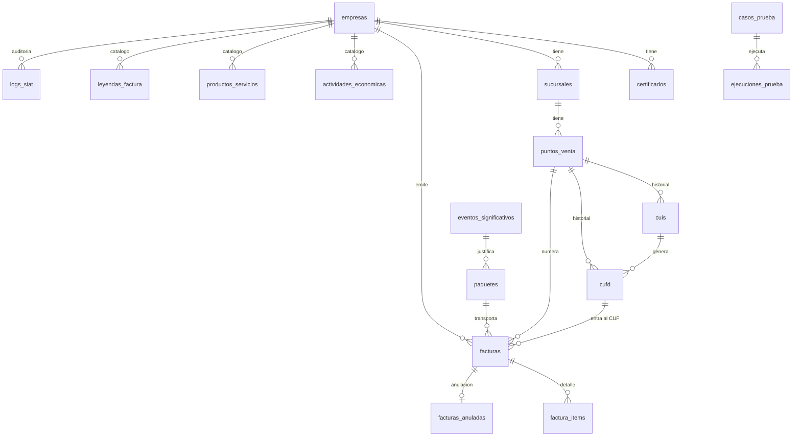

# Base de datos

> Esquema vigente (MySQL `siat_api`; los tests usan SQLite en memoria). Fuente de verdad:
> `database/migrations/`. Todo lo de un cliente cuelga de `empresa_id`.

---

## 1. Cliente

### `empresas`
| Columna | Tipo | Notas |
|---|---|---|
| `nombre_comercial`, `razon_social` | string | |
| `nit` | string(20) | Único junto con `codigo_ambiente` |
| `codigo_sistema` | string null | Asignado por el SIN |
| `token_delegado` | text null | **Cifrado** (`encrypted`) |
| `codigo_ambiente` | tinyint (2) | 1 producción, 2 piloto |
| `codigo_modalidad` | tinyint (1) | 1 electrónica |
| `estado` | string | `EN_REGISTRO` → `EN_PRUEBAS` → `PILOTO_APROBADO` → `PRODUCCION`; `OBSERVADO` |
| `webhook_url` | string null | Validada contra SSRF al guardar |

### `personal_access_tokens` (Sanctum)
Tokens de API. `tokenable_type`/`tokenable_id` → la **empresa** dueña · `name` · `token` (hash
SHA-256) · `abilities` (permisos, json) · `last_used_at` · `expires_at` · `ips_permitidas` (json,
propia de este sistema; vacío = cualquier IP). Modelo `App\Models\TokenApi`.

### `certificados`
`empresa_id` · `contenido_p12` (base64, **cifrado**) · `passphrase` (**cifrada**) · `emitido_por`
(`AUTOFIRMADO - solo pruebas` para los de prueba) · `vence_el` · `activo`. Ambos campos
sensibles están en `$hidden`.

---

## 2. Estructura física

### `sucursales`
`empresa_id` · `codigo_sucursal` (0 = casa matriz; único por empresa) · `nombre` · `municipio` ·
`direccion` · `telefono`. Se copian de la Oficina Virtual; el sistema no las crea en el SIN.

### `puntos_venta`
| Columna | Notas |
|---|---|
| `sucursal_id`, `codigo_punto_venta` | Únicos juntos. Código del SIN |
| `tipo_punto_venta` | Catálogo del SIN |
| `siguiente_factura` | **Correlativo**; se reserva con `lockForUpdate` |
| `activo` | Los dados de baja quedan por su historial |
| `registrado_en_siat` | Fecha del `registroPuntoVenta`. Null = solo local (salvo el PV 0) |

---

## 3. Códigos del SIN (historial)

### `cuis`
`punto_venta_id` · `codigo` · `fecha_vigencia` (la que declara el SIN). `updateOrCreate` por
código: pedirlo de nuevo no duplica.

### `cufd`
`punto_venta_id` · `cuis_id` (CUIS que lo generó) · `codigo` · `codigo_control` (entra al CUF) ·
`direccion` · `fecha_vigencia`. El vigente es el último por `id` no vencido.

---

## 4. Facturación

### `facturas`
| Columna | Notas |
|---|---|
| `empresa_id`, `punto_venta_id`, `cufd_id`, `paquete_id` | `paquete_id` solo para contingencia |
| `cuf` | **Único** |
| `numero_factura`, `fecha_emision` | Fecha en segundos (ms = 000) |
| `comprador_*` | Tipo y número de documento, complemento, razón social, email |
| `metodo_pago`, `numero_tarjeta` | Tarjeta **enmascarada** |
| `codigo_excepcion` | 0 normal, 1 = NIT no validado |
| `moneda`, `tipo_cambio` | Hoy siempre 1 y 1 |
| `subtotal`, `descuento_global`, `gift_card`, `monto_total`, `monto_total_moneda`, `monto_total_sujeto_iva` | decimal(14,2) |
| `leyenda`, `usuario` | |
| `codigo_documento_sector` | 1 |
| `tipo_emision` | 1 en línea, 2 contingencia (entra al CUF) |
| `estado` | Ver [ARQUITECTURA.md §5](ARQUITECTURA.md#5-máquina-de-estados-de-la-factura). Índice `(estado, id)` |
| `codigo_recepcion`, `codigo_estado_siat` | Respuesta del SIN |
| `motivo_observacion` | Por qué el SIN la observó (`[código] descripción`); null si no fue observada |
| `xml_firmado` | **Documento legal** |
| `ruta_pdf` | `storage/app/siat/pdf/{cuf}.pdf` |
| `referencia_externa` | Única por empresa: idempotencia |
| `enviada_en`, `validada_en` | |

### `factura_items`
`factura_id` · `codigo_producto_sin` · `codigo_actividad` (resuelta al emitir) · `codigo_interno` ·
`descripcion` · `cantidad` decimal(14,4) · `unidad_medida` · `precio_unitario` · `descuento` ·
`subtotal` · `numero_serie` · `numero_imei`.

### `facturas_anuladas`
`factura_id` · `motivo` · `anulada_en` · `codigo_recepcion` · `estado` (`PENDIENTE`, `CONFIRMADA`,
`RECHAZADA`, `REVERTIDA`) · `motivo_rechazo` · `estado_anterior` (para revertir si el SIN rechaza).

---

## 5. Operación

### `eventos_significativos`
`empresa_id` · `punto_venta_id` · `codigo_evento` (motivo 1–7) · `descripcion` · `cufd_evento`
(CUFD en uso al caer) · `fecha_inicio`, `fecha_fin` · `codigo_recepcion` (del SIN) · `estado`
(`ABIERTO`, `CERRADO`).

### `paquetes`
`empresa_id` · `punto_venta_id` · `evento_id` · `cantidad_facturas` · `codigo_recepcion` ·
`estado` (`PENDIENTE`, `ENVIADO`) · `enviado_en`.

### `logs_api`
`empresa_id` · `token_id` (sin FK: el historial sobrevive al token revocado) · `metodo` · `ruta` ·
`estado_http` · `ip` · `duracion_ms` · `created_at`. No guarda el cuerpo. Se purga a los 90 días
(`SIAT_API_RETENCION_LOGS_DIAS`).

### `logs_siat`
`empresa_id` · `servicio` · `operacion` · `xml_enviado` · `xml_recibido` · `duracion_ms` ·
`exitoso` · `mensaje_error` · `created_at`. Contiene datos del comprador: se purga a los 90 días.

---

## 6. Catálogos

| Tabla | Alcance | Clave |
|---|---|---|
| `catalogos` | Global (`tipo`, `codigo_clasificador`, `descripcion`) | único `(tipo, codigo_clasificador)` |
| `actividades_economicas` | Por empresa | único `(empresa_id, codigo_actividad)` |
| `productos_servicios` | Por empresa: producto homologado → actividad | único `productos_servicios_unico` (nombre explícito: MySQL limita a 64 caracteres) |
| `leyendas_factura` | Por empresa y actividad | |

---

## 7. Piloto

### `casos_prueba`
`fase` · `etapa` (null = flujo original de 17 pasos) · `orden` · `nombre` · `descripcion` · `tipo`
(operación a ejecutar) · `payload_ejemplo` (json, parámetros del portal) · `obligatorio` ·
`pruebas_esperadas`.

### `ejecuciones_prueba`
`empresa_id` · `caso_id` · `estado` · `respuesta` (json) · `duracion_ms` · `intento` ·
`ejecutado_en`.

---

## 8. Laravel

`users` (un solo administrador) · `sessions` · `password_reset_tokens` · `cache` · `cache_locks`
(locks de jobs únicos) · `jobs` · `job_batches` · `failed_jobs`.

---

## 9. Integridad

- Borrar una empresa cascadea a todo lo suyo, por eso el panel **impide borrar** una empresa que
  ya emitió facturas (documentos con obligación de conservación); para dejar de atenderla está
  el estado `OBSERVADO`.
- `facturas.cufd_id` y `paquetes.evento_id` quedan en null si se borra el padre.
- `logs_siat.empresa_id` queda en null: la auditoría sobrevive.
