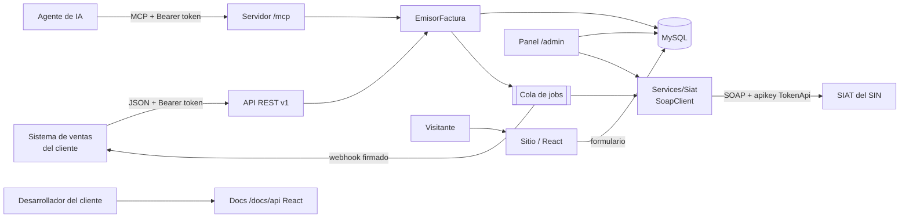
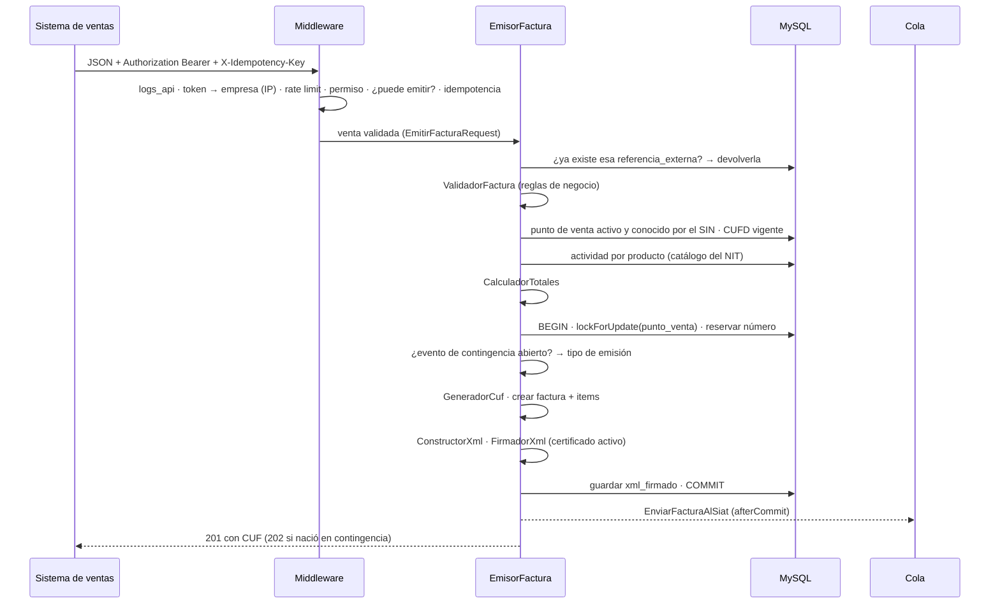
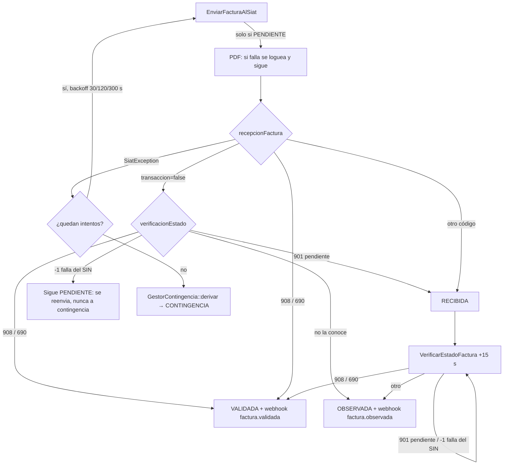
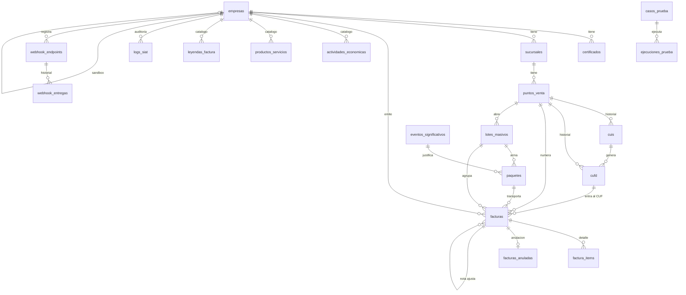

# Documentación técnica — siat-api

> Para desarrolladores: cómo está construido el sistema, cómo habla con el SIN y cómo se guardan los
> datos. Operar el servidor: [INSTALACION-Y-DESPLIEGUE.md](INSTALACION-Y-DESPLIEGUE.md). Integrar un sistema de ventas:
> [integracion/API.md](integracion/API.md).

**Contenido:** [Arquitectura](#arquitectura) · [Contrato con el SIAT](#contrato-con-el-siat) · [Base de datos](#base-de-datos) · [Pendientes](#pendientes)

---

## Arquitectura

Cómo está construido el sistema y por qué.

---

### Qué es

`siat-api` es un **proveedor de facturación electrónica** ante el SIAT (Servicio de Impuestos
Nacionales de Bolivia). Atiende a **varios clientes** (ferreterías, restaurantes, etc.) desde
una sola instalación.

| Aspecto | Valor |
|---|---|
| Modalidad | Electrónica en línea (`codigoModalidad = 1`) |
| Documentos | **Sector 1, Factura Compra Venta** (`codigoDocumentoSector = 1`, `tipoFacturaDocumento = 1`) y **sector 24, Nota de crédito-débito** (`tipoFacturaDocumento = 3`, servicio de documentos de ajuste) |
| Ambientes | 1 = producción, 2 = piloto (cada empresa tiene el suyo) |
| Stack | PHP 8.3 · Laravel 13 · MySQL · colas en base de datos · Blade (panel) · React 18 + Vite (sitio público y documentación) · `laravel/mcp` (agentes de IA) · Pest 4 |

El sistema de ventas del cliente **no habla SOAP ni firma nada**: manda un JSON a la API REST y
recibe el CUF al toque. Todo lo demás —CUIS, CUFD, CUF, XML, firma digital, envío, verificación,
anulación, contingencia, catálogos— lo resuelve este sistema.



---

### Mapa de carpetas

| Carpeta | Qué contiene |
|---|---|
| `app/Http/Controllers/Api/V1` | API REST para el sistema de ventas: facturas, lote, notas, anulación, emisión masiva, webhooks, certificado, puntos de venta, catálogos, dashboard, estado |
| `app/Http/Controllers/Sitio` | Sitio público `/` y su formulario de contacto (`routes/sitio.php`) |
| `app/Http/Controllers/Docs` | Documentación pública `/docs/api` |
| `app/Mcp` | Servidor MCP (`Servers/SiatServer`) y sus herramientas (`Tools/`), ruta en `routes/ai.php` |
| `app/Models/Sitio` | `SolicitudContacto` (formulario del sitio) |
| `resources/js/sitio`, `resources/js/docs` | Apps React del sitio y de la documentación (Vite) |
| `app/Http/Controllers/Admin` | Panel `/admin`: empresas (con *Crear sandbox*), certificados, sucursales, puntos de venta, códigos, piloto, monitor, trabajos, comunicación SIAT, solicitudes de contacto |
| `app/Http/Middleware` | `siat.registro`, `siat.token`, `siat.permiso`, `siat.rate`, `siat.produccion`, `siat.idempotencia` |
| `app/Http/Requests` | Validación de forma del JSON (emitir, lote, nota, anular, anulación administrativa; `Sitio/` para el contacto) |
| `app/Services/Factura` | Emisión de facturas y notas, anulación, emisión masiva (`GestorMasiva`), carga de certificados, validación, totales, CUF, XML, firma, PDF, QR |
| `app/Services/Siat` | **Única frontera SOAP**: cliente, servicios por WSDL, gestor de CUIS/CUFD, lectura de respuestas |
| `app/Services/Contingencia` | Eventos significativos y armado de paquetes |
| `app/Services/Catalogos` | Sincronización de catálogos globales y por NIT |
| `app/Services/Pruebas` | Ejecutor del piloto ante el SIN |
| `app/Services/Panel` | Lógica del panel (colores de estado, checklist de etapa, **Comunicación SIAT**) y acciones compartidas con la API: `CreadorSandbox`, `RegistradorPuntoVenta` |
| `app/Services/Webhooks` | Validación del destino (anti-SSRF) y `Notificador`, que reparte cada evento entre los destinos registrados por el cliente |
| `app/Jobs` | Trabajo en segundo plano (envío, verificación, anulación, paquetes, webhooks, CUFD, piloto) |
| `app/Console/Commands` | Comandos `siat:*` (ver [INSTALACION-Y-DESPLIEGUE.md](INSTALACION-Y-DESPLIEGUE.md#5-comandos-siat)) |
| `app/Http/Controllers/FacturaPublicaController.php` | Factura pública con enlace firmado (`Factura::urlPublica`): página, PDF carta, ticket 80 mm, mini ticket y ZIP |
| `app/Http/Controllers/Docs/DocumentacionApiController.php` | Documentación pública `/docs/api` y `/docs/api/{pagina}` (app React de `resources/js/docs`), más `openapi.yaml` con el servidor real y las descargas de Postman |
| `routes/console.php` | Tareas programadas |
| `config/siat.php` | Toda la configuración propia del dominio |

---

### Reglas de diseño

1. **Nada de SOAP fuera de `app/Services/Siat/`.** Nadie más construye un `SoapClient`. Jobs,
   comandos y controladores piden los servicios a `FabricaServicios`, que se resuelve del
   contenedor y en los tests se reemplaza con Mockery.
2. **La venta nunca espera al SIN.** La emisión es síncrona hasta tener el XML firmado (~150 ms)
   y el viaje al SIN es asíncrono.
3. **Multi-empresa por `empresa_id`.** Cada consulta de la API filtra por la empresa autenticada;
   cada empresa tiene su token, su certificado, su ambiente y sus catálogos.
4. **El documento firmado es inmutable.** Actividad económica, leyenda, código de excepción y
   montos se resuelven al emitir y quedan guardados: un cambio posterior de catálogos no altera
   una factura ya emitida.
5. **El SIN rechaza sin SoapFault.** Responde HTTP 200 con `transaccion = false`; por eso toda
   respuesta pasa por `RespuestaSiat`, que distingue aceptación de rechazo y extrae el motivo.
6. **Sin roles.** Un solo administrador del panel (decisión de producto).

---

### Flujo de emisión

#### Parte síncrona (`POST /api/v1/facturas`)



Detalles clave (todos en `app/Services/Factura/EmisorFactura.php`):

- **Correlativo sin huecos ni duplicados.** El número se reserva dentro de la transacción con
  bloqueo de fila del punto de venta. Si algo falla después (por ejemplo, la firma), el rollback
  devuelve el número.
- **Fecha sin milisegundos.** `fecha_emision` se guarda en segundos y el CUF lleva la fecha con
  milisegundos: se usa `now()->startOfSecond()` para que el CUF y `<fechaEmision>` coincidan.
- **Tipo de emisión antes del CUF.** El tipo de emisión es uno de los nueve campos del CUF; se
  decide (en línea o contingencia) antes de calcularlo.
- **Certificado.** Sin certificado activo no se emite (la modalidad electrónica exige firma). Un
  certificado **vencido** tampoco firma (el SIN rechazaría todo), y un autofirmado de prueba no
  puede firmar en ambiente de producción.
- **Tarjeta.** `numero_tarjeta` se enmascara antes de guardar (4 primeros + ceros + 4 últimos).
- **Idempotencia.** Índice único `(empresa_id, referencia_externa)`; si dos peticiones iguales
  corren en paralelo, la que pierde la carrera devuelve la factura de la que ganó.

#### Parte asíncrona



---

### Máquina de estados de la factura

| Estado | Significado | Sale hacia |
|---|---|---|
| `PENDIENTE` | Emitida y firmada; todavía no viajó | `RECIBIDA`, `VALIDADA`, `OBSERVADA`, `CONTINGENCIA` (una nota de crédito-débito nunca: queda `PENDIENTE` y se reintenta) |
| `RECIBIDA` | El SIN acusó recibo individual, sin validar aún | `VALIDADA`, `OBSERVADA`, `ANULADA` |
| `ENVIADA` | Viajó dentro de un paquete de contingencia | `VALIDADA`, `OBSERVADA`, `ANULADA` |
| `VALIDADA` | El SIN la aceptó (908/690) | `ANULADA` |
| `OBSERVADA` | El SIN la rechazó; no se reintenta (el documento no cambia) | — |
| `CONTINGENCIA` | Válida e imprimible, pendiente de viajar en un paquete | `ENVIADA` |
| `MASIVA` | Emitida con un lote de emisión masiva abierto (tipo de emisión 3); válida, espera el cierre del lote | `ENVIADA` → `VALIDADA` / `OBSERVADA` (por paquete) |
| `ANULADA` | Anulación registrada (ver `facturas_anuladas.estado`) | vuelve al estado anterior si el SIN rechaza la anulación |

Anulación (`facturas_anuladas.estado`): `PENDIENTE` → `CONFIRMADA` | `RECHAZADA` (la factura vuelve
a su `estado_anterior`) | `REVERTIDA` (por el panel o `POST /facturas/{cuf}/revertir-anulacion`).
Una anulación administrativa (`tipo = ADMINISTRATIVA`) nace `CONFIRMADA`, sin SOAP, y no se revierte.
Las notas de crédito-débito usan los mismos estados.

---

### Trabajo asíncrono

#### Jobs

Van en tres colas que el worker atiende por prioridad (`--queue=facturas,default,piloto`):
`facturas` (envío, verificación, anulación, paquetes), `default` (webhooks, CUFD, catálogos) y
`piloto` (pruebas). Así una etapa del piloto de un cliente nuevo no atrasa la facturación de los
demás. La cola se declara con el atributo `#[Queue('...')]` en cada job.

| Job | Disparado por | Intentos / backoff | Qué hace |
|---|---|---|---|
| `EnviarFacturaAlSiat` | Emisión (afterCommit), tarea `reintentar-pendientes` | 3 · 30/120/300 s | Genera PDF y llama `recepcionFactura`. Solo actúa sobre facturas `PENDIENTE`. Ante un rechazo consulta `verificacionEstadoFactura` antes de observar (un reenvío tras timeout vuelve como duplicado): 908/690 = `VALIDADA`, 902 = `RECIBIDA`, si no responde queda `PENDIENTE`. Agotados los intentos, deriva a contingencia |
| `VerificarEstadoFactura` | `EnviarFacturaAlSiat`, tarea `verificar-enviadas` | 5 · 60/120/300/600 s | Llama `verificacionEstadoFactura`. 901 (pendiente) o -1 (excepción interna del SIN) = reintenta; 902 = rechazada → `OBSERVADA`. En el último intento no se reencola: la retoma la tarea programada |
| `AnularFacturaEnSiat` | `POST .../anular`, tarea `reintentar-anulaciones` | 5 · 30/120/300/900 s | Llama `anulacionFactura`. **Único por factura** (`ShouldBeUnique`, 1 h). Si el SIN rechaza, verifica antes el estado: si ya figura anulada (reintento tras timeout) la confirma; si sigue vigente revierte la factura; si no responde queda `PENDIENTE`. Agotados los intentos queda `PENDIENTE` |
| `EnviarPaqueteContingencia` | `siat:recuperar-contingencia`, piloto | 3 · 60/300/900 s | Arma el TAR, llama `recepcionPaqueteFactura`, marca las facturas `ENVIADA` |
| `NotificarWebhook` | Cambios de estado | 5 · 10/30/60/120 s | POST firmado al `webhook_url` del cliente, con IP fijada y sin seguir redirecciones (anti-SSRF). En el primer intento reparte además el evento entre los destinos registrados (`Notificador`) |
| `EntregarWebhook` | `Notificador` | 8 · 10 s … 1 h | Entrega un aviso a un destino registrado por el cliente, firmado con el secreto de ese destino, y guarda el resultado en `webhook_entregas`. Agotado, queda `FALLIDA` (el cliente lo puede reenviar) |
| `EnviarPaqueteMasivo` | Cierre de un lote masivo | 4 · 60/300/900 s | Arma el TAR y llama `recepcionMasivaFactura`; si el SIN lo recibe, agenda la validación |
| `ValidarPaqueteMasivo` | `EnviarPaqueteMasivo`, tarea `validar-paquetes-masivos` | 6 · 60 s … 20 min | Llama `validacionRecepcionMasivaFactura`: valida u observa todas las facturas del paquete y avisa por webhook |
| `RenovarCufd` | `siat:renovar-cufds` | 3 | Pide un CUFD nuevo (y el CUIS antes si venció). Ignora puntos de venta no registrados en el SIN y empresas sin token. Si falla del todo, avisa con el webhook `cufd.renovacion_fallida` |
| `EjecutarCasoPrueba` | Panel del piloto | — | Ejecuta una llamada del piloto (etapas largas) |
| `SincronizarCatalogosEmpresa` | Tarea `sincronizar-catalogos-empresas` | 3 · 300/900 s | Sincroniza actividades, productos homologados y leyendas del NIT con un punto de venta que tenga CUIS vigente (se salta la empresa si no hay). El panel tiene además el botón **Sincronizar ahora** (síncrono) |

#### Historial de trabajos

`App\Services\Trabajos\RegistroTrabajos` escucha los eventos de la cola (`JobQueued`,
`JobProcessing`, `JobProcessed`, `JobExceptionOccurred`, `JobFailed`, `JobRetryRequested`, `Looping`)
y lleva la tabla `trabajos`: una fila por job (uuid del payload) con estado `EN_COLA` →
`PROCESANDO` → `EXITOSO` / `REINTENTANDO` / `FALLIDO`, intentos, duración, error, empresa y lo que
afecta (factura, paquete, punto de venta). Los jobs no saben que existe. También lleva el **latido**
del worker (cache, cada 15 s como máximo) y lee el del scheduler (tarea `latido-scheduler`, cada
minuto) para el semáforo del panel. Todo va en `try/catch`: el historial nunca rompe un job.
Pantalla: `Admin\TrabajoController`. Limpieza: `siat:purgar-logs` (exitosos 7 días, resto 30).

#### Tareas programadas (`routes/console.php`)

| Frecuencia | Tarea | Qué hace |
|---|---|---|
| cada 5 min | `reintentar-pendientes` | Reencola facturas `PENDIENTE` con más de 10 min (máx. 200) |
| cada 10 min | `siat:recuperar-contingencia` | Si el SIAT responde: registra el evento, lo cierra y despacha el paquete |
| cada 15 min | `verificar-enviadas` | Reencola la verificación de `ENVIADA`/`RECIBIDA` con más de 20 min |
| cada 15 min | `reintentar-anulaciones` | Reencola anulaciones `PENDIENTE` con más de 30 min |
| cada 15 min | `validar-paquetes-masivos` | Vuelve a pedir el resultado de los paquetes masivos `ENVIADO` con más de 45 min |
| cada hora | `siat:renovar-cufds` | Renueva los CUFD que vencen en menos de 2 h |
| diario 02:00 | `siat:revisar-codigos` | Pide un CUIS nuevo a los puntos de venta que lo perdieron (no se puede antes: con uno vigente el SIN devuelve el mismo) |
| diario 04:00 | `siat:purgar-logs` | Borra `logs_siat` más viejos que la retención |
| diario 07:00 | `siat:avisar-certificados` | Alerta certificados y tokens delegados vencidos o que vencen en menos de 30 días (al log) y manda el webhook `certificado.por_vencer` a los 30, 15, 7, 3 y 1 días |
| diario 03:30 | `sincronizar-catalogos-empresas` | Despacha `SincronizarCatalogosEmpresa` por cada empresa con token |
| domingo 03:00 | `siat:sincronizar-globales` | Catálogos paramétricos globales |

#### CUFD en dos capas

Los sistemas de venta **no manejan códigos**: la API los consigue sola.

- **Preventiva:** `siat:renovar-cufds` cada hora renueva lo que vence en menos de 2 h.
- **Reactiva:** si al emitir no hay CUFD vigente, `EmisorFactura` lo pide en ese momento
  (`GestorCodigos::asegurarCufd`, con lock por punto de venta para que dos cajas no pidan dos).
  Si el SIN falla, responde `503 SIAT_NO_DISPONIBLE` y no reintenta durante 60 s; en contingencia
  ni lo intenta (solo sumaría la espera del timeout).
- **CUIS:** `siat:revisar-codigos` diario y, si falta al pedir un CUFD, se pide antes. Cuando el
  SIN entrega un CUIS **nuevo**, se pide en seguida un CUFD atado a él (`GestorCodigos::renovarCuis`):
  el SIN rechaza con 913 un CUFD que viaja con un CUIS distinto al que lo generó.
- **Emergencia:** `POST /api/v1/puntos-venta/{s}/{pv}/cufd` (permiso `codigos:renovar`, 3 por hora).

---

### Frontera SOAP (`app/Services/Siat`)

| Clase | Responsabilidad |
|---|---|
| `SiatClient` | Construye el `SoapClient`: URL del WSDL por ambiente, cabecera `apikey: TokenApi {token}`, gzip, traza, y **timeout de lectura** (`default_socket_timeout`) tanto al bajar el WSDL como al invocar |
| `ServicioBase` | Cabecera común (`codigoAmbiente`, `codigoSistema`, `codigoModalidad`, `nit`), invocación y auditoría en `logs_siat` (XML enviado/recibido, duración y `exitoso`, que solo dice si hubo comunicación: un rechazo del SIN llega con HTTP 200 y queda en 1; la pantalla **Comunicación SIAT** distingue aceptada / rechazada / sin respuesta leyendo `transaccion`). Envuelve todo error en `SiatException` |
| `ServicioCodigos` | `verificarComunicacion`, `cuis`, `cufd`, `verificarNit` |
| `ServicioSincronizacion` | `sincronizarFechaHora`, actividades, productos/servicios, leyendas y cualquier otra paramétrica por el nombre de su operación (`parametrica()`) |
| `ServicioOperaciones` | `registroPuntoVenta`, `consultaPuntoVenta`, `cierreOperacionesSistema`, `registroEventoSignificativo` |
| `ServicioFacturacion` | `recepcionFactura`, `verificacionEstadoFactura`, `anulacionFactura`, `reversionAnulacionFactura`, `recepcionPaqueteFactura`, `validacionRecepcionPaqueteFactura`. Comprime en gzip y calcula el SHA-256 **del gzip** |
| `GestorCodigos` | Único lugar que pide y guarda CUIS/CUFD (`asegurarCuis`, `asegurarCufd`, `renovarCufd`, `renovarCuis`, `forzarCuisNuevo`). Rechaza respuestas sin código o sin código de control; usa la vigencia que declara el SIN; ata cada CUFD al CUIS que lo generó |
| `RespuestaSiat` | Interpreta `transaccion`, `codigoRecepcion`, `codigoEstado`, `mensajesList` |
| `FabricaServicios` | Construye los servicios por empresa; punto de sustitución en tests |

Detalles del contrato con el SIN (qué está verificado y qué no) en
[Contrato con el SIAT](#contrato-con-el-siat).

---

### Emisión: componentes de `app/Services/Factura`

| Clase | Qué hace |
|---|---|
| `ValidadorFactura` | Reglas que el FormRequest no cubre: descuentos que superan la línea, total negativo, gift card mayor al total, excepción de NIT sin documento NIT. También la usa el piloto, que emite sin FormRequest |
| `CalculadorTotales` | Subtotales por línea, monto total = bruto − descuentos de línea − descuento global; **sujeto a IVA = monto total − gift card**. Redondeo a 2 decimales |
| `ResolutorActividad` | Actividad económica por producto homologado y leyenda (al azar entre las de la actividad) |
| `GeneradorCuf` | 9 campos a ancho fijo (53 dígitos) + verificador módulo 11 → base 16 + código de control del CUFD |
| `ConstructorXml` | `facturaElectronicaCompraVenta` con `xsi:noNamespaceSchemaLocation`; los vacíos van con `xsi:nil="true"` |
| `FirmadorXml` | Firma XML-DSig enveloped RSA-SHA256 con el `.p12`. **XAdES-BES pendiente** |
| `MontoEnLetras` | Monto en literal para el "Son: … 00/100 BOLIVIANOS" |
| `GeneradorPdf` / `GeneradorQr` | Representación imprimible (dompdf) y QR de verificación; la URL del QR depende del ambiente de la empresa (`siat.qr.urls`) |
| `GeneradorCertificadoPrueba` | `.p12` autofirmado, solo para el piloto |

---

### Contingencia (`app/Services/Contingencia`)

1. `EnviarFacturaAlSiat` agota sus intentos → `GestorContingencia::derivar()` marca la factura
   `CONTINGENCIA` y abre un `EventoSignificativo` (motivo 1) con el CUFD en uso.
2. Mientras el evento está abierto, cada factura nueva nace con `tipo_emision = 2` y su CUF lo
   refleja.
3. `siat:recuperar-contingencia` (cada 10 min) sondea con `verificarComunicacion`; si el SIAT
   responde, registra el evento en el SIN (pidiendo CUFD nuevo si hace falta), lo cierra y arma un
   `Paquete` con las facturas acumuladas.
4. `EnviarPaqueteContingencia` envía el TAR (un XML firmado por factura) con `codigoEvento`.

> ⚠️ Este flujo tiene problemas abiertos que se resuelven junto con la Etapa VI y el CAFC: las
> facturas derivadas conservan un CUF de emisión en línea y el paquete viaja con
> `codigoEmision = 2`; la fecha de inicio del evento es posterior a esas facturas; no hay tope de
> facturas por paquete. Ver [Pendientes](#pendientes).

---

### Seguridad

| Tema | Cómo se resuelve |
|---|---|
| Autenticación API | Tokens de **Laravel Sanctum** cuyo dueño es la `Empresa` (no un usuario). **Uno por empresa** (regenerarlo revoca el anterior en la misma transacción: `Empresa::reemplazarTokenApi`), prefijo `siat_`, solo se guarda su hash, se muestran una vez. Vencimiento, IPs permitidas y revocación desde el panel (Empresa → *Acceso API*). La sesión del panel no autentica la API (`sanctum.guard = []`) |
| Autorización API | Cada ruta exige un permiso (`siat.permiso:...`); perfiles *Caja / POS*, *Administración*, *Solo consulta* en `config/siat.php` |
| Registro de llamadas | `logs_api`: token, empresa, ruta, código HTTP, IP, duración (también los rechazos); purgado a los 90 días |
| Token delegado, `.p12`, passphrase | Cifrados en reposo (cast `encrypted`, `APP_KEY`); ocultos al serializar |
| Aislamiento | Toda consulta de la API filtra por `empresa_id` |
| Rate limit | 60 peticiones/min por token y 120 por empresa (`SIAT_RATE_LIMIT_TOKEN`, `SIAT_RATE_LIMIT`) |
| Proxies | `TRUSTED_PROXIES`: solo a esos proxies se les cree `X-Forwarded-For` |
| Panel | Middleware `auth`; login con 5 intentos y bloqueo de 60 s |
| Webhooks | Destino validado contra SSRF (https, IP pública); IP fijada con `CURLOPT_RESOLVE` contra DNS rebinding; cuerpo firmado HMAC-SHA256 con un **secreto por empresa** |
| Tarjetas | Enmascaradas antes de guardar y firmar |
| Auditoría SOAP | `logs_siat` con XML completo, purgado a los 90 días |

---

## Contrato con el SIAT

Cómo habla este sistema con el SIN, con el nivel de confianza de cada dato.

Niveles:

- ✅ **Verificado**: contrastado con el WSDL del piloto, con respuestas reales del SIN o con
  `ventas` (sistema del mismo autor que factura en producción, modalidad computarizada).
- ⚠️ **Pendiente**: sale de documentación o deducción; confirmar antes de producción.

---

### Identidad del proveedor

Solicitud R-1359 nº 9484 (09/08/2026): NIT 7633685015 · sistema *SolucionDigital-api* ·
código de sistema `22848EC6F66C9401C16F7` · tipo PROVEEDOR · modalidad electrónica en línea.

---

### Transporte

| Tema | Valor | Nivel |
|---|---|---|
| URL piloto | `https://pilotosiatservicios.impuestos.gob.bo/sfd/{Servicio}?wsdl` (v3; `/v2` dejó de registrar facturas el 16/10/2026) | ✅ |
| URL producción | `https://siatrest.impuestos.gob.bo/v2/{Servicio}?wsdl` | ⚠️ |
| Servicios | `FacturacionCodigos`, `FacturacionSincronizacion`, `FacturacionOperaciones`, `ServicioFacturacionCompraVenta` | ✅ |
| Token | Cabecera HTTP **`apikey: TokenApi {token_delegado}`** (no `Authorization`) | ✅ |
| Rechazos | HTTP 200 con `transaccion = false` y `mensajesList`, **no** SoapFault | ✅ |
| Fechas | Hora de Bolivia, formato `Y-m-d\TH:i:s.v` | ✅ |

Cabecera común de casi toda solicitud: `codigoAmbiente`, `codigoSistema`, `codigoModalidad`,
`nit`.

---

### Códigos: CUIS y CUFD

| Tema | Detalle | Nivel |
|---|---|---|
| CUIS | Operación `cuis`. Dura ~1 año. Si ya hay uno vigente el SIN responde `transaccion=false` con **código 980** pero **devuelve el mismo CUIS**: no es error | ✅ |
| Vigencia | Se usa la `fechaVigencia` que declara el SIN, no "ahora + 1 año": un CUIS existente vence antes | ✅ |
| CUFD | Operación `cufd`. Dura 24 h. **Cada solicitud devuelve uno nuevo**. Trae `codigo`, `codigoControl`, `direccion`, `fechaVigencia` | ✅ |
| CUFD ↔ CUIS | Cada CUFD queda atado al CUIS con que se pidió. Mandar un CUFD con otro CUIS da **913 "CUIS INVALIDO"**. Por eso, cuando el SIN entrega un CUIS **nuevo**, el sistema pide también un CUFD nuevo; si devuelve el mismo (980), no | ✅ |
| CUFD vigente | El último insertado (`latest('id')`) no vencido; no por fecha, que se rompió al corregir la zona horaria | ✅ |
| Punto de venta 0 | Existe en el SIN sin registrarlo; tiene su propio CUIS y CUFD | ✅ |
| Registrar PV | `registroPuntoVenta` crea uno **nuevo cada vez**; un PV no se borra, solo se cierra, y cerrado no se reabre | ✅ |

---

### CUF

```
nit(13) + fecha AAAAMMDDHHIISSmmm(17) + sucursal(4) + modalidad(1) + tipoEmision(1)
+ tipoFactura(1) + documentoSector(2) + numeroFactura(10) + puntoVenta(4)   = 53 dígitos
→ + dígito verificador módulo 11                                             = 54 dígitos
→ a base 16 (mayúsculas)
→ + codigoControl del CUFD
```

| Tema | Detalle | Nivel |
|---|---|---|
| Anchos | `tipoFactura` ocupa **1** dígito, `documentoSector` 2 | ✅ |
| Módulo 11 | Pesos 2..9 ciclando de derecha a izquierda; dígito = **`suma % 11`** (no `11 − resto`); 10 → 1, 11 → 0 | ✅ |
| Fecha | La del CUF debe ser idéntica a `<fechaEmision>`; por eso se emite con milisegundos en `000` | ✅ |
| Tipo de emisión | 1 en línea, 2 fuera de línea; entra al CUF | ✅ |

Implementación: `app/Services/Factura/GeneradorCuf.php`.

---

### XML de la factura (sector 1, electrónica)

| Tema | Detalle | Nivel |
|---|---|---|
| Raíz | `facturaElectronicaCompraVenta` (la computarizada es `facturaComputarizadaCompraVenta`) | ✅ |
| Atributos raíz | `xmlns:xsi` + `xsi:noNamespaceSchemaLocation="facturaElectronicaCompraVenta.xsd"` | ✅ |
| Vacíos | Presentes con `xsi:nil="true"` (el XSD es una secuencia), salvo `complemento`: en V3 es obligatorio y no nillable, vacío va como `<complemento/>` (`ConstructorXml::VACIO_SIN_NIL`) | ✅ |
| XSD | V3 (IVA Transparente, Ley 1733): `CompraVentaXML.zip` del anexo técnico en **siatanexo**.impuestos.gob.bo (artículo 231). El de siatinfo sigue siendo V2. Copia en `tests/Fixtures/xsd-v3`, y los tests validan el XML contra ella | ✅ |
| Orden de campos | El del XSD V3 | ✅ (validado contra el XSD) |
| Precios | **Netos**, sin IVA: `precioNetoUnitario`. La API recibe `precio_unitario` neto | ✅ |
| Montos | `subTotalNeto` = Σ `subTotal`; `totalPrecioNeto` = subTotalNeto − `descuentoAdicional` − `montoGiftCard`; `iva` = 13% de totalPrecioNeto; `montoaPagar` = totalPrecioNeto + iva (`CalculadorTotales`, cuadra con el ejemplo del SIN) | ✅ |
| `codigoExcepcion` | `0` normal; `1` = NIT no validado (solo documento 5). En V3 va después de `descuentoAdicional` | ✅ (`ventas`) |
| `cafc` | Ya no existe en V3 | ✅ |
| `codigoInterno` | Obligatorio en V3 ("Código Interno SIN"). `empresas.codigo_interno`, por defecto `A` como en los ejemplos del SIN | ⚠️ confirmar el valor con el SIN |
| `cantidad` | 2 decimales en V3 (antes 4) | ✅ |
| `montoTotalMoneda` / `tipoCambio` | Hoy solo bolivianos: igual a `montoaPagar`, cambio 1 | ✅ |
| `actividadEconomica` | Del catálogo de productos homologados del NIT | ✅ |
| `leyenda` | Del catálogo de leyendas de la actividad, al azar | ✅ |

Cabecera, en orden: `nitEmisor`, `razonSocialEmisor`, `municipio`, `telefono`, `numeroFactura`,
`cuf`, `cufd`, `codigoSucursal`, `direccion`, `codigoPuntoVenta`, `fechaEmision`,
`nombreRazonSocial`, `codigoTipoDocumentoIdentidad`, `numeroDocumento`, `complemento`,
`codigoCliente`, `codigoMetodoPago`, `numeroTarjeta`, `subTotalNeto`, `totalPrecioNeto`, `iva`,
`montoaPagar`, `codigoMoneda`, `tipoCambio`, `montoTotalMoneda`, `montoGiftCard`,
`descuentoAdicional`, `codigoExcepcion`, `leyenda`, `usuario`, `codigoInterno`,
`codigoDocumentoSector`.

Detalle, en orden: `actividadEconomica`, `codigoProductoSin`, `codigoProducto`, `descripcion`,
`cantidad`, `unidadMedida`, `precioNetoUnitario`, `montoDescuento`, `subTotal`, `numeroSerie`,
`numeroImei`.

En la base, `facturas.subtotal` es el subTotalNeto, `total_precio_neto` e `iva` sus columnas, y
`monto_total` el montoaPagar (ya sin la gift card). `monto_total_sujeto_iva` quedó sin uso.

---

### Nota de crédito-débito (sector 24, electrónica)

Devolución total o parcial de una factura validada. Vive en la tabla `facturas` con
`codigo_documento_sector = 24` y `factura_origen_id`, así reusa envío, verificación, anulación,
PDF, webhook y panel. La emite `App\Services\Factura\EmisorNotaCreditoDebito`.

| Tema | Detalle | Nivel |
|---|---|---|
| Servicio SOAP | `ServicioFacturacionDocumentoAjuste`: `recepcionDocumentoAjuste`, `anulacionDocumentoAjuste`, `reversionAnulacionDocumentoAjuste`, `verificacionEstadoDocumentoAjuste`; envoltorio `SolicitudServicio{Operación}DocumentoAjuste`; misma struct base que compra-venta | ✅ WSDL piloto `/sfd` (2026-10-18) |
| Contingencia | El servicio **no tiene operaciones de paquete**: la nota solo se emite en línea; con evento abierto se rechaza y si el SIAT cae después queda `PENDIENTE` | ✅ WSDL |
| CUF | Mismo algoritmo con `tipoFactura` = 3 (documento de ajuste) y sector 24 | ✅ (go-siat) |
| XSD | V3: `CreditoDebitoXML.zip` del anexo técnico (siatanexo, artículo 285), copia en `tests/Fixtures/xsd-v3` | ✅ (validado contra el XSD) |
| Raíz XML | `notaFiscalElectronicaCreditoDebito` + `.xsd` | ✅ (go-siat) |
| `codigoDetalleTransaccion` | 1 = item de la factura original, 2 = item devuelto. Van todos los originales y después los devueltos | ✅ (go-siat) |
| `nroItem` | Posición de la línea en la factura; el devuelto lleva el de la línea de la que sale | ✅ (ejemplo del SIN) |
| Montos `...Original` | Los de la factura tal como se emitió | ✅ |
| Montos `...Devuelto` | `subTotalNetoDevuelto` = Σ líneas devueltas; `montoDescuentoDevuelto` = `descuentoAdicional` prorrateado; `totalPrecioNetoDevuelto` = la resta; `ivaDevuelto` = 13%; `montoaPagarDevuelto` = neto + IVA | ✅ (cuadra con el ejemplo del SIN) |
| Descuento en cero | El XSD declara `descuentoAdicionalOriginal` y `montoDescuentoDevuelto` con `minExclusive 0` y sin nil: una factura sin descuento adicional no validaría. Se manda `0.00` | ⚠️ ver qué acepta el piloto |
| Correlativo | `puntos_venta.siguiente_nota`, aparte del de facturas | ⚠️ contrastar en el piloto |
| Gift card | Facturas con gift card no admiten nota todavía | ⚠️ |
| Certificación | El sector 24 se certifica aparte ante el SIN; no hay casos en el piloto del panel | ❌ pendiente |

Cabecera, en orden: `nitEmisor`, `razonSocialEmisor`, `municipio`, `telefono`,
`numeroNotaCreditoDebito`, `cuf`, `cufd`, `codigoSucursal`, `direccion`, `codigoPuntoVenta`,
`fechaEmision`, `nombreRazonSocial`, `codigoTipoDocumentoIdentidad`, `numeroDocumento`,
`complemento`, `codigoCliente`, `numeroFactura`, `numeroAutorizacionCuf`, `fechaEmisionFactura`,
`subTotalNetoOriginal`, `totalPrecioNetoOriginal`, `ivaOriginal`, `montoaPagarOriginal`,
`subTotalNetoDevuelto`, `totalPrecioNetoDevuelto`, `ivaDevuelto`, `montoaPagarDevuelto`,
`descuentoAdicionalOriginal`, `montoDescuentoDevuelto`, `codigoExcepcion`, `leyenda`, `usuario`,
`codigoInterno`, `codigoDocumentoSector`.

Detalle: `nroItem` primero, después como el de la factura sin `numeroSerie`/`numeroImei`, y con
`codigoDetalleTransaccion` al final.

---

### Emisión masiva (tipo de emisión 3)

| Tema | Detalle | Nivel |
|---|---|---|
| Operaciones | `recepcionMasivaFactura` (envoltorio `SolicitudServicioRecepcionMasiva`, struct = recepción + `cantidadFacturas`) y `validacionRecepcionMasivaFactura` (`SolicitudServicioValidacionRecepcionMasiva`, base + `codigoRecepcion`) | ✅ WSDL piloto `/sfd` (2026-10-18) |
| Paquete | El mismo TAR de XML firmados que contingencia (`ArmadorPaquete`), hasta 500 por paquete | ⚠️ contrastar en el piloto |
| CUF | `tipo_emision` = 3 mientras el lote del punto de venta está abierto | ⚠️ contrastar en el piloto |
| Observación parcial | Si el SIN observa solo algunas facturas, hoy se observa el paquete entero | ⚠️ pendiente |
| Autorización | El NIT necesita autorización del SIN para emisión masiva | ❌ trámite del cliente |

Flujo: `GestorMasiva::abrir` → `EmisorFactura` emite en `MASIVA` (lee el lote con el punto de
venta bloqueado) → `GestorMasiva::cerrar` arma paquetes `tipo = MASIVA` → `EnviarPaqueteMasivo` →
`ValidarPaqueteMasivo` (y la tarea `validar-paquetes-masivos` cada 15 min).

---

### Firma digital

| Tema | Detalle | Nivel |
|---|---|---|
| Tipo | XML-DSig enveloped, RSA-SHA256, C14N, digest SHA-256, `X509Certificate` en `KeyInfo` | Implementado |
| Canonicalización | El `SignedInfo` se canonicaliza **en su lugar** (hereda `xmlns:xsi` de la raíz); suelto no verifica | ✅ (openssl_verify) |
| Perfil XAdES-BES | `QualifyingProperties` armado pero **no enchufado** (`FirmadorXml::construirQualifyingProperties`) | ⚠️ **bloqueante** |
| Dudas XAdES | Versión del namespace (1.3.2 vs 1.4.1), `SignedDataObjectProperties`, digest del certificado, formato de `X509IssuerName`, patrón de los `Id` | ⚠️ |

Se confirma en la Etapa IV/VIII del piloto con el `.p12` real. Si el SIN acepta la firma XML-DSig
simple, el bloque XAdES no hace falta.

---

### Recepción, estado y anulación

| Tema | Detalle | Nivel |
|---|---|---|
| Struct base `solicitudRecepcion` | `codigoAmbiente`, `codigoDocumentoSector`, `codigoEmision`, `codigoModalidad`, `codigoPuntoVenta`, `codigoSistema`, `codigoSucursal`, `cufd`, `cuis`, `nit`, `tipoFacturaDocumento` | ✅ WSDL piloto |
| `recepcionFactura` | + `archivo` (XML firmado en **gzip**), `fechaEnvio`, `hashArchivo` | ✅ |
| `hashArchivo` | SHA-256 **del gzip**, no del XML | ✅ |
| `verificacionEstadoFactura` | + `cuf` | ✅ |
| `anulacionFactura` | + `cuf`, `codigoMotivo`; con el **CUFD vigente**, no el de la emisión | ✅ |
| `reversionAnulacionFactura` | + `cuf` (sin motivo) | ✅ WSDL piloto |
| Códigos | **908 y 690 = validada** (ventas); **902 = rechazada** y **-1 = excepción interna del SIN** (respuestas reales del piloto, 2026-10-17); 901 = pendiente (catálogo, sin verificar) | ✅ |
| 935 | `fechaEnvio` fuera de tolerancia (zona horaria) | ✅ |

---

### Eventos y paquetes (contingencia)

| Tema | Detalle | Nivel |
|---|---|---|
| `registroEventoSignificativo` | `codigoMotivoEvento`, `descripcion`, `cuis`, `cufd` (vigente), `cufdEvento` (el de la caída, **distinto** del vigente), `fechaHoraInicioEvento`, `fechaHoraFinEvento`, sucursal y PV. Respuesta bajo `RespuestaListaEventos`, código en `codigoRecepcionEventoSignificativo` | ✅ WSDL piloto |
| Motivos | 1 corte de internet · 2 inaccesibilidad del servicio web · 3 zonas sin internet · 4 venta sin internet · 5 virus/falla de software · 6 cambio de infraestructura/hardware · 7 corte de energía | ✅ portal |
| `recepcionPaqueteFactura` | Struct base + `cafc`, `cantidadFacturas`, `codigoEvento`, `archivo`, `fechaEnvio`, `hashArchivo` | ✅ WSDL piloto |
| Archivo | **TAR** con un XML firmado por factura, comprimido en gzip | ✅ |
| `validacionRecepcionPaqueteFactura` | Confirma el procesamiento del paquete | ✅ nombre |
| Máximo por paquete | 500 facturas (el portal pide "igual a 500" y "menor a 500") | ✅ portal |
| CAFC | Necesario para los motivos 5–7 (facturación manual) | ⚠️ en trámite con el SIN |

---

### Sincronización de catálogos

Operaciones: `sincronizarFechaHora`, `sincronizarActividades`,
`sincronizarListaProductosServicios`, `sincronizarListaLeyendasFactura`,
`sincronizarListaMensajesServicios`, `sincronizarListaActividadesDocumentoSector` y las
paramétricas `sincronizarParametrica*` (unidad de medida, tipo de moneda, documento de
identidad, método de pago, motivo de anulación, documento sector, país de origen, tipo de punto
de venta, entre otras). Todas requieren `cuis`, `codigoSucursal`, `codigoPuntoVenta`. Un rechazo
viene con `transaccion=false` dentro del envoltorio de cada operación (`RespuestaSiat::rechazoDeCatalogo`).

---

### QR de verificación

| Tema | Valor | Nivel |
|---|---|---|
| Piloto | `https://pilotosiat.impuestos.gob.bo/consulta/QR` | ✅ (`ventas`) |
| Producción | `https://siat.impuestos.gob.bo/consulta/QR` | ⚠️ mismo camino en el dominio principal; confirmar |
| Parámetros | `nit`, `cuf`, `numero`, `t` | ✅ (`ventas`) |
| `t` | `2` (media página / carta; `1` = rollo), configurable con `SIAT_QR_TAMANIO` | ✅ valor de `ventas`; significado a confirmar |

---

## Base de datos

Esquema vigente (MySQL; los tests usan SQLite en memoria). Fuente de verdad: `database/migrations/`.



`solicitudes_contacto` (formulario del sitio público) no se relaciona con nada.

---

### Cliente

#### `empresas`
| Columna | Tipo | Notas |
|---|---|---|
| `nombre_comercial`, `razon_social` | string | |
| `nit` | string(20) | Único junto con `codigo_ambiente` |
| `codigo_sistema` | string null | Asignado por el SIN |
| `token_delegado` | text null | **Cifrado** (`encrypted`) |
| `codigo_ambiente` | tinyint (2) | 1 producción, 2 piloto |
| `codigo_modalidad` | tinyint (1) | 1 electrónica |
| `estado` | string | `EN_REGISTRO` → `EN_PRUEBAS` → `PILOTO_APROBADO` → `PRODUCCION`; `OBSERVADO` |
| `webhook_url` | string null | Validada contra SSRF al guardar |
| `sandbox_de_id` | FK null | Solo en un sandbox: la empresa de producción de la que es copia (panel → *Crear sandbox*) |

Sandbox: una empresa con `codigo_ambiente = 2` emite por la API en `EN_PRUEBAS`, `PILOTO_APROBADO`
o `PRODUCCION` (`Empresa::puedeEmitirPorApi`); en producción solo en `PRODUCCION`. Los tokens llevan
prefijo por ambiente (`siat_test_` / `siat_live_`, `Empresa::generateTokenString`) y se revocan al
cambiar el ambiente.

#### `personal_access_tokens` (Sanctum)
Tokens de API. `tokenable_type`/`tokenable_id` → la **empresa** dueña · `name` · `token` (hash
SHA-256) · `abilities` (permisos, json) · `last_used_at` · `expires_at` · `ips_permitidas` (json,
propia de este sistema; vacío = cualquier IP). Modelo `App\Models\TokenApi`.

#### `certificados`
`empresa_id` · `contenido_p12` (base64, **cifrado**) · `passphrase` (**cifrada**) · `emitido_por`
(`AUTOFIRMADO - solo pruebas` para los de prueba) · `vence_el` · `activo`. Ambos campos
sensibles están en `$hidden`.

#### `cafcs`
`empresa_id` · `codigo` (único por empresa, en mayúsculas) · `numero_inicio` / `numero_fin` (rango
que autorizó el SIN) · `ultimo_numero` (null = ninguno usado) · `activo` (uno solo por empresa;
cargar otro desactiva el anterior). Va **por empresa**: el SIN lo emite para un NIT. Solo lo usan
los eventos significativos 5, 6 y 7 (facturación manual). Se carga en la ficha de la empresa.

---

### Estructura física

#### `sucursales`
`empresa_id` · `codigo_sucursal` (0 = casa matriz; único por empresa) · `nombre` · `municipio` ·
`direccion` · `telefono`. Se copian de la Oficina Virtual; el sistema no las crea en el SIN.

#### `puntos_venta`
| Columna | Notas |
|---|---|
| `sucursal_id`, `codigo_punto_venta` | Únicos juntos. Código del SIN |
| `tipo_punto_venta` | Catálogo del SIN |
| `siguiente_factura` | **Correlativo**; se reserva con `lockForUpdate` |
| `siguiente_nota` | Correlativo de notas de crédito-débito, igual que el de facturas |
| `activo` | Los dados de baja quedan por su historial |
| `registrado_en_siat` | Fecha del `registroPuntoVenta`. Null = solo local (salvo el PV 0) |

---

### Códigos del SIN (historial)

#### `cuis`
`punto_venta_id` · `codigo` · `fecha_vigencia` (la que declara el SIN). `updateOrCreate` por
código: pedirlo de nuevo no duplica.

#### `cufd`
`punto_venta_id` · `cuis_id` (CUIS que lo generó) · `codigo` · `codigo_control` (entra al CUF) ·
`direccion` · `fecha_vigencia`. El vigente es el último por `id` no vencido.

---

### Facturación

#### `facturas`
| Columna | Notas |
|---|---|
| `empresa_id`, `punto_venta_id`, `cufd_id`, `paquete_id` | `paquete_id` solo para contingencia |
| `cuf` | **Único** |
| `numero_factura`, `fecha_emision` | Fecha en segundos (ms = 000) |
| `comprador_*` | Tipo y número de documento, complemento, razón social, email |
| `metodo_pago`, `numero_tarjeta` | Tarjeta **enmascarada** |
| `codigo_excepcion` | 0 normal, 1 = NIT no validado |
| `moneda`, `tipo_cambio` | Hoy siempre 1 y 1 |
| `subtotal`, `descuento_global`, `gift_card`, `monto_total`, `monto_total_moneda`, `monto_total_sujeto_iva` | decimal(14,2) |
| `leyenda`, `usuario` | |
| `codigo_documento_sector` | 1 factura, 24 nota de crédito-débito |
| `factura_origen_id` | Solo en una nota: la factura que ajusta |
| `lote_masivo_id` | Solo si se emitió con un lote de emisión masiva abierto |
| `monto_efectivo_credito_debito` | Solo en una nota: 13% de lo devuelto. En la nota, `subtotal` = suma de líneas devueltas y `descuento_global` = descuento prorrateado |
| `tipo_emision` | 1 en línea, 2 contingencia, 3 masiva (entra al CUF) |
| `estado` | Ver [Máquina de estados](#máquina-de-estados-de-la-factura). Índice `(estado, id)` |
| `codigo_recepcion`, `codigo_estado_siat` | Respuesta del SIN |
| `motivo_observacion` | Por qué el SIN la observó (`[código] descripción`); null si no fue observada |
| `xml_firmado` | **Documento legal** |
| `ruta_pdf` | `storage/app/siat/pdf/{cuf}.pdf` |
| `referencia_externa` | Única por empresa: idempotencia |
| `enviada_en`, `validada_en` | |

#### `factura_items`
`factura_id` · `codigo_producto_sin` · `codigo_actividad` (resuelta al emitir) · `codigo_interno` ·
`descripcion` · `cantidad` decimal(14,4) · `unidad_medida` · `precio_unitario` · `descuento` ·
`subtotal` · `numero_serie` · `numero_imei` · `codigo_detalle_transaccion` (solo en notas: 1
original, 2 devuelto) · `item_origen_id` (solo en notas: la línea de la factura; controla que no se
devuelva dos veces lo mismo).

#### `facturas_anuladas`
`factura_id` · `tipo` (`SIAT` por servicio web; `ADMINISTRATIVA` = aprobada por trámite fuera de
plazo, se registra sin SOAP y no se revierte) · `numero_resolucion` (solo administrativa) · `motivo` ·
`anulada_en` · `codigo_recepcion` · `estado` (`PENDIENTE`, `CONFIRMADA`, `RECHAZADA`, `REVERTIDA`) ·
`motivo_rechazo` · `estado_anterior` (para revertir si el SIN rechaza).

---

### Webhooks registrados por el cliente

#### `webhook_endpoints`
`empresa_id` · `url` (validada contra SSRF al guardar y en cada entrega) · `eventos` (json: `*`,
`grupo.*` o exactos, catálogo en `config('siat.webhooks.eventos')`) · `descripcion` · `secreto`
(**cifrado**, `whsec_…`) · `activo`. Máximo 10 por empresa.

#### `webhook_entregas`
`uuid` (va en `X-Siat-Entrega`) · `webhook_endpoint_id` · `evento` · `cuerpo` (los bytes exactos
que se firman y reenvían) · `estado` (`PENDIENTE`, `ENTREGADA`, `FALLIDA`) · `intentos` ·
`codigo_http` · `error` · `entregada_en`. Las crea `Services\Webhooks\Notificador` y las manda
`EntregarWebhook` (reintentos en `config('siat.webhooks.reintentos')`). El webhook único
`empresas.webhook_url` sigue igual (`NotificarWebhook`).

#### `lotes_masivos`
`empresa_id` · `punto_venta_id` · `estado` (`ABIERTO`, `CERRADO`) · `abierto_en` · `cerrado_en`.
`facturas.lote_masivo_id` y `paquetes.lote_masivo_id` / `paquetes.tipo` (`CONTINGENCIA`, `MASIVA`)
/ `paquetes.motivo_observacion` lo completan.

### Sitio público (portada `/`)

App React (Vite) separada del resto, todo en su propia carpeta:

| Pieza | Dónde |
|---|---|
| Rutas | `routes/sitio.php` (cargado en `bootstrap/app.php` con el grupo `web`): `GET /` y `POST /contacto` (throttle `sitio-contacto`) |
| Controladores | `app/Http/Controllers/Sitio/` (`InicioController`, `ContactoController`) |
| Request | `app/Http/Requests/Sitio/EnviarContactoRequest` (campo trampa `sitio_web` para bots) |
| Modelo | `app/Models/Sitio/SolicitudContacto` → tabla `solicitudes_contacto` (`nombre`, `empresa`, `correo`, `telefono`, `interes`, `mensaje`, `ip`, `atendida_en`) |
| Vista | `resources/views/sitio/app.blade.php`: monta React y le pasa los datos en un JSON incrustado |
| App React | `resources/js/sitio/` (`main.jsx`, `App.jsx`, `componentes/*.jsx`, `sitio.css` sin Tailwind). Identidad de Solución Digital (soluciondigital.dev): fondo azul noche, cian + violeta, Poppins/Inter. Animaciones con `motion` (todas respetan "reducir movimiento"); íconos `@phosphor-icons/react`; logos de la franja desde Simple Icons |
| Configuración | `config/sitio.php` (`SITIO_*` del `.env`; el logo por defecto es el de soluciondigital.dev) |
| Panel | *Solicitudes* (`/admin/solicitudes`, `Admin\SolicitudContactoController`) |

El sitio **no publica precios ni planes** (lo controla un test). WhatsApp y correo solo se muestran si
están en el `.env`.

### Documentación de la API (`/docs/api`)

App React aparte del sitio, en su propia carpeta: `resources/js/docs/` (`App.jsx`, `componentes/`,
`contenido/`, `docs.css`), vista `resources/views/docs/app.blade.php`, controlador
`Controllers/Docs/DocumentacionApiController`. **Fuente única**, leída al compilar:

- `contenido/guia.js` parte `docs/integracion/API.md` en páginas por cada `## `. De la sección de
  endpoints, cada `### `METODO /ruta`` se pega como "Detalle y reglas" a la página de ese endpoint.
- `contenido/referencia.js` arma una página por operación de `openapi.yaml` (parámetros, cuerpo,
  respuestas, ejemplos de petición en 4 lenguajes y de respuesta desde los esquemas).

Cada página tiene su URL (`/docs/api/post-facturas`, `/docs/api/webhooks`...). Editar `API.md` u
`openapi.yaml` exige `npm run build` (en desarrollo, `npm run dev` lo recarga solo).

### Servidor MCP

`routes/ai.php` → `App\Mcp\Servers\SiatServer` en `POST /mcp`, detrás de `siat.registro`,
`siat.token` y `siat.rate`. Las herramientas (`app/Mcp/Tools`) heredan de `HerramientaSiat`, que
toma la empresa del request y exige el permiso del endpoint REST equivalente.

### Operación

#### `eventos_significativos`
`empresa_id` · `punto_venta_id` · `codigo_evento` (motivo 1–7) · `descripcion` · `cufd_evento`
(CUFD en uso al caer) · `fecha_inicio`, `fecha_fin` · `codigo_recepcion` (del SIN) · `estado`
(`ABIERTO`, `CERRADO`).

#### `paquetes`
`empresa_id` · `punto_venta_id` · `tipo` (`CONTINGENCIA` o `MASIVA`) · `evento_id` (contingencia) ·
`lote_masivo_id` (masiva) · `cantidad_facturas` · `codigo_recepcion` · `estado` (`PENDIENTE`,
`ENVIADO`; los masivos además `VALIDADO` u `OBSERVADO`) · `motivo_observacion` · `enviado_en`.

#### `logs_api`
`empresa_id` · `token_id` (sin FK: el historial sobrevive al token revocado) · `metodo` · `ruta` ·
`estado_http` · `ip` · `duracion_ms` · `created_at`. No guarda el cuerpo. Se purga a los 90 días
(`SIAT_API_RETENCION_LOGS_DIAS`).

#### `trabajos`
`uuid` (único; el del payload, igual en reintentos y en `failed_jobs`) · `clase` · `cola` · `estado`
(`EN_COLA`, `PROCESANDO`, `EXITOSO`, `REINTENTANDO`, `FALLIDO`) · `intentos` · `empresa_id` ·
`relacionado_tipo` / `relacionado_id` · `error` · `duracion_ms` · `encolado_en`, `iniciado_en`,
`terminado_en`. Se purga: exitosos a los 7 días, el resto a los 30.

### `logs_siat`
`empresa_id` · `servicio` · `operacion` · `xml_enviado` · `xml_recibido` · `duracion_ms` ·
`exitoso` · `mensaje_error` · `created_at`. Contiene datos del comprador: se purga a los 90 días.

---

### Catálogos

| Tabla | Alcance | Clave |
|---|---|---|
| `catalogos` | Global (`tipo`, `codigo_clasificador`, `descripcion`) | único `(tipo, codigo_clasificador)` |
| `actividades_economicas` | Por empresa | único `(empresa_id, codigo_actividad)` |
| `productos_servicios` | Por empresa: producto homologado → actividad | único `productos_servicios_unico` (nombre explícito: MySQL limita a 64 caracteres) |
| `leyendas_factura` | Por empresa y actividad | |

---

### Piloto

#### `casos_prueba`
`fase` · `etapa` (null = flujo original de 17 pasos) · `orden` · `nombre` · `descripcion` · `tipo`
(operación a ejecutar) · `payload_ejemplo` (json, parámetros del portal) · `obligatorio` ·
`pruebas_esperadas`.

#### `ejecuciones_prueba`
`empresa_id` · `caso_id` · `estado` · `respuesta` (json) · `duracion_ms` · `intento` ·
`ejecutado_en`.

---

### Laravel

`users` (un solo administrador) · `sessions` · `password_reset_tokens` · `cache` · `cache_locks`
(locks de jobs únicos) · `jobs` · `job_batches` · `failed_jobs`.

---

### Integridad

- Borrar una empresa cascadea a todo lo suyo, por eso el panel **impide borrar** una empresa que
  ya emitió facturas (documentos con obligación de conservación); para dejar de atenderla está
  el estado `OBSERVADO`.
- `facturas.cufd_id` y `paquetes.evento_id` quedan en null si se borra el padre.
- `logs_siat.empresa_id` queda en null: la auditoría sobrevive.

---

## Pendientes

Lo que falta, casi todo esperando algo externo. El historial de cambios está en `git log`.

### Bloqueantes de producción

| # | Problema | Dónde | Plan |
|---|---|---|---|
| B1 | **Firma XAdES-BES** sin confirmar. Hoy se firma XML-DSig simple | `FirmadorXml` | Probar en Etapa IV con el `.p12` real; si el SIN rechaza, enchufar `construirQualifyingProperties()` |
| B2 | **Passphrase del `.p12`** desconocida (`~/Escritorio/certificado-prueba.p12`) | — | Conseguirla con la entidad certificadora |
| B3 | **Contingencia — tipo de emisión mezclado.** Las facturas derivadas a contingencia conservan un CUF de emisión 1 (en línea) y el paquete viaja con `codigoEmision = 2`; el SIN recalcula el CUF y rechazaría el paquete entero. También nacen en línea las facturas emitidas durante los ~7,5 min de reintentos antes de abrir el evento | `GestorContingencia::derivar`, `EnviarPaqueteContingencia` | Reenviar las derivadas por `recepcionFactura` cuando vuelva el SIAT y usar paquete solo para las de emisión 2. Se hace con la Etapa VI |
| B4 | **Contingencia — fecha del evento.** `fecha_inicio` es el momento en que se abre el evento, posterior a la `fecha_emision` de las facturas que lo causaron | `GestorContingencia::eventoAbierto` | Fijarla en la emisión de la primera factura que falló |
| B5 | **Contingencia — CUFD vencido bloquea la venta.** Si el CUFD vence durante una caída, `EmisorFactura` responde 503 aunque haya evento abierto | `EmisorFactura::emitir` | En contingencia, emitir con el CUFD del evento |
| B6 | **Paquete de contingencia sin tope.** El SIN admite hasta 500 facturas por paquete (la emisión masiva ya los parte) | `GestorContingencia::recuperar` | Partir en paquetes de 500, como `GestorMasiva::cerrar` |
| B7 | **CAFC**: ya se carga por empresa (tabla `cafcs`, ficha de la empresa), pero todavía no se usa: falta emitir las facturas manuales de los eventos 5–7 con el CAFC y un número de su rango, y mandarlo en el paquete | `EmisorFactura`, `ConstructorXml`, `EnviarPaqueteContingencia` | Etapa VI. El SIN entregó el CAFC del piloto el 2026-10-14 |

### Por verificar en el piloto (funciones agregadas el 2026-10-18)

Construidas y con tests, pero **sin probar contra el SIN real**. Contrato SOAP verificado contra los
WSDL del piloto `/sfd`; el XML de la nota, contra el SDK go-siat, no contra el XSD oficial.

| # | Pendiente | Dónde | Qué hacer |
|---|---|---|---|
| V1 | **Certificar la nota de crédito-débito (sector 24)** ante el SIN: no hay casos de prueba del sector 24 en el panel del piloto | `CasosPruebaSeeder`, `EjecutorPruebas` | Agregar los casos del sector 24 que pida el portal y correrlos |
| V2 | **XML de la nota** contra el XSD oficial `notaFiscalElectronicaCreditoDebito.xsd`: orden de campos, `montoDescuentoCreditoDebito` (hoy prorrateo propio del descuento adicional) y correlativo propio por punto de venta | `ConstructorXml::cabeceraNota`, `EmisorNotaCreditoDebito::montos` | Conseguir el XSD y emitir una nota en el piloto |
| V3 | **Nota sobre facturas con gift card**: hoy se rechaza (no se sabe cómo prorratea el SIN la base del crédito fiscal) | `EmisorNotaCreditoDebito::validarOrigen` | Confirmar la regla con el SIN |
| V4 | **Emisión masiva sin probar**: formato del paquete (TAR como contingencia), `tipo_emision = 3` en el CUF, códigos de `validacionRecepcionMasivaFactura` | `GestorMasiva`, `EnviarPaqueteMasivo`, `ValidarPaqueteMasivo` | Pedir al SIN la autorización de emisión masiva para un NIT de prueba y mandar un lote |
| V5 | **Emisión masiva — observación parcial**: si el SIN observa solo algunas facturas del paquete, hoy se observa el paquete entero | `ValidarPaqueteMasivo` | Ver en el piloto cómo identifica las facturas (¿`numeroArchivo`?) |
| V6 | **Sandbox de un cliente en producción**: falta confirmar que el SIN siga aceptando facturas del piloto para un NIT que ya pasó a producción | `CreadorSandbox` | Probar con el primer cliente en producción |
| V7 | **Anulación administrativa**: solo se registra en local; confirmar que `verificacionEstadoFactura` la muestre anulada | `AnuladorFactura::anularAdministrativamente` | Probar con una anulación aprobada por trámite |
| V8 | **Revertir anulación de una nota** (`reversionAnulacionDocumentoAjuste`) sin probar | `ServicioFacturacion::invocarPara` | Incluir en la certificación del sector 24 |

### Operativos de la versión 2026-10-18

| # | Pendiente | Qué hacer |
|---|---|---|
| O1 | Los tokens de *Administración* emitidos antes no traen el permiso `webhooks:gestionar` | Regenerar el token a los clientes que quieran webhooks por API |
| O2 | El panel no muestra los destinos de webhook registrados por API ni los lotes masivos (solo se ven por la API) | Agregar en *Acceso API* y en la ficha si hace falta |
| O3 | El servidor MCP solo acepta token Bearer; los clientes MCP que solo hablan OAuth no se conectan | Agregar Passport si un cliente lo pide (cambia dependencias: aprobar) |
| O4 | Las herramientas MCP no cubren lote, emisión masiva, webhooks ni autogestión | Agregarlas si los clientes las usan |

### Otros

| # | Problema | Dónde |
|---|---|---|
| P3 | **URL de producción del SIAT** (servicios y consulta del QR) sin verificar | `config/siat.php` |
| P4 | **Orden de campos del XML** sin contrastar contra el XSD oficial | `ConstructorXml` |
| P5 | `validacionRecepcionPaqueteFactura` solo se usa en el piloto; en producción las facturas del paquete quedan `ENVIADA` hasta la verificación individual | `EnviarPaqueteContingencia` |
| P6 | Moneda extranjera no soportada (solo Bs) | `EmitirFacturaRequest` |
| P8 | Los tests de concurrencia contra MySQL (grupo `mysql`) se borraron con la suite Feature antigua (`d5bc968`); recuperables desde `7ba2acd` | `tests/` |
| P9 | El código de evento de contingencia automática es fijo en 1 (corte de internet) | `GestorContingencia` |
